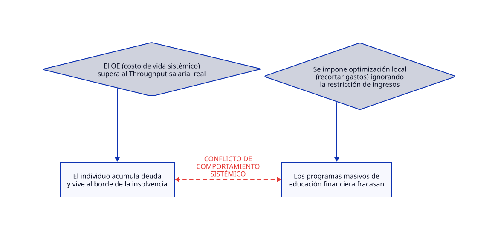

# TERMODINÁMICA FINANCIERA 08

## 1. Titular y Resumen Ejecutivo: La Ilusión del Presupuesto frente a la Restricción Sistémica

[Educacion financiera](https://www.eleconomista.com.mx/finanzaspersonales/educacion-financiera-funciona-dice-foro-economico-mundial-20261007-837387.html)

El Foro Económico Mundial (WEF) ha puesto sobre la mesa un debate incómodo pero necesario: **la educación financiera tradicional no funciona**. Pretender resolver la precariedad económica y el endeudamiento masivo de los hogares mediante talleres de ahorro, presupuestos y recortes individuales equivale a intentar mantener cientos de pelotas de ping pong bajo el agua en una piscina presurizada. El fallo no reside en una supuesta ignorancia del consumidor, sino en una falla sistémica: el costo operativo vital ($OE$) supera con creces el Throughput ($T$) salarial real disponible para la base de la pirámide económica global.

---

## 2. Diagnóstico del Sistema según TOC

Bajo la óptica de la **Teoría de Restricciones (TOC)**, el sistema socioeconómico actual impone un cuello de botella físico y estructural en la generación de ingresos reales para los individuos, mientras que los costos de supervivencia (vivienda, salud, alimentos, energía) escalan de manera inelástica.

* **Throughput ($T$):** La velocidad de creación y captura de riqueza por parte del trabajador está limitada por estructuras de mercado asimétricas y salarios reales estancados.
* **Inventario / Inversión ($I$):** Pasivos obligatorios (deudas por consumo básico y compromisos habitacionales) que actúan como anclas financieras inevitables.
* **Gasto de Operación ($OE$):** El costo mínimo de existencia en el sistema, impulsado por dinámicas inflacionarias globales que escapan por completo al control del individuo.

---

## 3. Dicotomía Clave 1: Contabilidad de Costos Tradicional vs. Contabilidad del Throughput (TA)

* **La Visión de la Contabilidad de Costos Tradicional:**
Evalúa al individuo bajo la premisa errónea de la *eficiencia local*. Lo trata como un centro de costos ineficiente al que hay que auditar, recortando gastos hormiga y minimizando partidas individuales (el café, las suscripciones, el ocio). Asume que la salud financiera es una simple ecuación aritmética de disciplina microeconómica, culpando directamente a la víctima del sistema por su falta de "austeridad".
* **La Visión de la Contabilidad del Throughput (TA):**
Comprende que el $OE$ (gasto operativo) tiene un límite biológico inferior irreductible: no se puede recortar el costo de subsistencia por debajo de cero sin colapsar al agente. El foco de la TA dictamina que **la riqueza y la viabilidad no provienen de exprimir el $OE$ localmente, sino de maximizar el $T$ y eliminar las restricciones sistémicas** que limitan la capacidad de generar valor real en el mercado. Si el entorno estrangula el flujo de ingresos, cualquier manual de finanzas personales se vuelve operativamente estéril.

---

## 4. Dicotomía Clave 2: Teoría Monetaria Moderna (MMT) vs. Teoría de Restricciones (TOC)

* **Visión MMT:**
Analiza el problema desde la macroeconomía de la moneda soberana, argumentando que los gobiernos con monopolio de emisión no enfrentan restricciones financieras nominales, sino restricciones reales de recursos (inflación y capacidad instalada). Sostiene que la precariedad de los hogares refleja fallas en la distribución agregada y en la falta de redes de seguridad pública (como un empleo garantizado), postulando que la solución requiere calibración fiscal y monetaria a nivel macro.
* **Visión TOC:**
Sostiene que, independientemente de los arreglos monetarios o de la soberanía de emisor, **la restricción fundamental es siempre física, operativa y de capacidad productiva real**. Si las políticas de inyección de liquidez o los desequilibrios macroeconómicos expanden la masa monetaria sin elevar la capacidad real de producción y oferta de bienes básicos, el resultado neto es el incremento del costo de vida ($OE$ macroeconómico), lo que pulveriza aún más el poder adquisitivo y acelera el colapso del flujo individual, volviendo obsoletas las intervenciones nominales.

---

## 5. Conclusión y Prescripción Estratégica (5 Pasos de Enfoque de Goldratt)

Aplicar los 5 Pasos de Enfoque de Eliyahu Goldratt al colapso de la educación financiera exige abandonar el falso debate de la culpa individual y rediseñar el sistema:

1. **Identificar la Restricción:** Reconocer que el verdadero cuello de botella no es la falta de conocimientos matemáticos del ciudadano, sino la brecha estructural entre el costo de vida ($OE$) y la generación de ingresos reales ($T$).
2. **Explotar la Restricción:** Dejar de perder energía intentando exprimir centavos en presupuestos de supervivencia; aceptar que los márgenes locales están saturados.
3. **Subordinar todo lo demás a la Restricción:** Alinear las políticas públicas, educativas y laborales para enfocar los recursos en la expansión de la capacidad productiva y salarial de la base social, en lugar de descargar la responsabilidad en programas de austeridad individual.
4. **Elevar la Restricción:** Reestructurar los mercados, incentivar la innovación productiva y romper los cuellos de botella macroeconómicos que deprimen el valor del trabajo humano.
5. **Prevenir la Inercia:** Evitar que el sistema caiga de nuevo en el dogma de culpar al eslabón más débil (el consumidor), manteniendo una vigilancia constante sobre los flujos reales de valor y costo de la economía.
