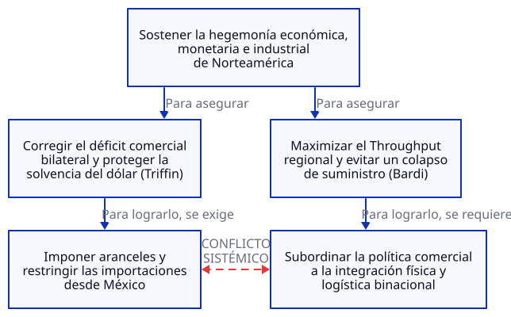

# Termodinámica Financiera 09: Déficit Comercial México-EE. UU.

[Déficit comercial México-EE. UU.](https://www.eleconomista.com.mx/empresas/aumenta-deficit-comercial-estados-unidos-mexico-septiembre-20261109-842947.html) · [Publicado en iesencial.com](https://www.iesencial.com/boletin/#art=2026-11-12-Boletin-09%3A%20Deficit%20comercial%20mex-usa.md)

## 1. Titular y Resumen Ejecutivo

**Aumenta 26.1% el déficit comercial de Estados Unidos con México a septiembre de 2026: La trampa sistémica del dólar, la fragilidad del nearshoring y la ilusión de la eficiencia local.**

Mientras la política económica estadounidense interpreta el déficit bilateral de $184,019M (con exportaciones mexicanas de $481,586M) como una hemorragia industrial que exige aranceles, el análisis sistémico revela una realidad opuesta: Estados Unidos opera atrapado en el **Dilema de Triffin**, exportando dólares para sostener su hegemonía financiera a costa de su capacidad física. Al integrar la **Teoría de Restricciones (TOC)** con el **Efecto Séneca** de Ugo Bardi, demostramos que restringir este flujo mediante barreras comerciales no reindustrializa a Norteamérica, sino que empuja a la cadena de suministro regional hacia un precipicio de colapso no lineal.

---

## 2. Marco Teórico: La Tríada Sistémica del Colapso y el Enfoque

Para comprender la verdadera naturaleza del desequilibrio comercial entre México y Estados Unidos, integramos tres lentes fundamentales bajo la arquitectura lógica de la **Teoría de Restricciones (TOC)**:

1. **Robert Triffin (La Contradicción Monetaria Estructural):** El Dilema de Triffin establece que el país emisor de la moneda de reserva global (el dólar estadounidense) está obligado a proveer liquidez al sistema mundial incurriendo en déficits comerciales crónicos. Sin embargo, la acumulación perpetua de pasivos externos erosiona su base manufacturera interna y la confianza en su solvencia a largo plazo. Bajo la TOC, el diseño monetario global fuerza a que la liquidez financiera opere estructuralmente en contra de la capacidad física de producción local ($I$ y $OE$).

2. **Ugo Bardi (La Dinámica Temporal y el Efecto Séneca):** El Efecto Séneca demuestra que los sistemas complejos sometidos a estrés acumulado y rendimientos decrecientes no declinan de forma lineal o gradual. Mientras el crecimiento y la integración comercial son procesos lentos y laboriosos, el colapso ante un choque exógeno —como una guerra arancelaria o una ruptura logística— es abrupto, asimétrico y acelerado ("el crecimiento es lento, pero la ruina es rápida").

3. **Eliyahu M. Goldratt (El Eje de Control de Sistemas Complejos):** La Teoría de Restricciones trasciende la mera optimización de valor para erigirse como la ley fundamental de la dinámica de sistemas complejos: **el desempeño global de cualquier sistema interdependiente no está determinado por la suma de sus eficiencias locales, sino que está gobernado y controlado por un único elemento (la restricción o cuello de botella)**. Intentar optimizar subcomponentes aislados —como forzar el equilibrio de la balanza bilateral— sin elevar la capacidad de la restricción real del sistema destruye el rendimiento total y precipita la caída en la curva de Séneca.

---

## 3. Diagnóstico del Sistema según TOC

El sistema bajo análisis es el **bloque industrial y monetario de Norteamérica**. El flujo real revela que México no actúa como un extractor de riqueza de Estados Unidos, sino como la válvula de escape y extensión productiva que permite a las corporaciones norteamericanas sostener su oferta ante la escasez de capacidad manufacturera interna.

### Identificación de la Restricción y Parámetros ($T$, $I$, $OE$)

* **La Restricción del Sistema (Cuello de Botella):** La **capacidad física, energética y logística integrada de Norteamérica** (infraestructura transfronteriza, aduanas, generación eléctrica y mano de obra técnica calificada) para transformar insumos en bienes finales competitivos frente a los bloques asiáticos.
* **Throughput ($T$):** La tasa a la que el bloque norteamericano genera dinero fresco mediante ventas reales al consumidor final. El incremento de 20.7% en las importaciones estadounidenses de bienes mexicanos —con el equipo de cómputo como principal impulsor— representa el flujo vital que mantiene vivo el Throughput de las empresas estadounidenses.
* **Inversión / Inventario ($I$):** Todo el capital inmovilizado en plantas industriales, relocalización de cadenas de suministro (nearshoring), inventarios en tránsito y los propios bonos del Tesoro estadounidense acumulados en el exterior como contrapartida del déficit comercial (Dilema de Triffin).
* **Gasto de Operación ($OE$):** El costo sistémico necesario para convertir el inventario en Throughput. Los aranceles, las fricciones aduanales y la duplicación de cadenas productivas inflan artificialmente el $OE$ sin añadir un solo dólar de valor al sistema.

### Procesos de Pensamiento: El Dilema Sistémico de Norteamérica

---

## 4. Dicotomía Clave 1: Contabilidad de Costos Tradicional vs. Contabilidad del Throughput (TA)

La lectura política del déficit de $184,019M está secuestrada por los principios obsoletos de la **Contabilidad de Costos**, que asume que cada eslabón de una cadena debe mostrar un saldo positivo aislado para que el conjunto sea rentable.

* **La Visión de la Contabilidad de Costos Tradicional:** Observa la balanza comercial bilateral como un estado de resultados estático. Concluye que importar $481,586M desde México equivale a una "pérdida neta" de empleos y capital. Su receta es la optimización local: cerrar la frontera mediante aranceles para forzar que la manufactura regrese a territorio estadounidense, asumiendo que reducir el déficit bilateral mejorará automáticamente el desempeño nacional.
* **La Visión de la Contabilidad del Throughput (TA):** Demuestra que en sistemas altamente interdependientes, **la suma de los óptimos locales no es igual al óptimo global**. Gran parte de las importaciones desde México son bienes intermedios y manufactura integrada cuya producción dentro de EE. UU. es físicamente inviable a corto plazo debido a la escasez de mano de obra y costos energéticos. Estrangular el flujo proveniente de México mediante aranceles eleva el $OE$ y paraliza las líneas de ensamblaje finales en EE. UU., destruyendo el Throughput ($T$) de todo el sistema y detonando el **Efecto Séneca**: una caída abrupta en la disponibilidad de bienes y un repunte inflacionario severo.

---

## 5. Dicotomía Clave 2: Teoría Monetaria Moderna (MMT) vs. Teoría de Restricciones (TOC)

El debate sobre el déficit comercial estadounidense suele polarizarse entre quienes temen la insolvencia fiscal y quienes proclaman la omnipotencia del emisor monetario.

* **Visión de la Teoría Monetaria Moderna (MMT):** Argumenta que Estados Unidos, al ser el emisor monopolista del dólar en un régimen de tipo de cambio flotante, no enfrenta ninguna restricción financiera nominal. Bajo la identidad de balances sectoriales, el déficit comercial de EE. UU. es simplemente el superávit de ahorro en dólares del resto del mundo (incluido México). Para la MMT, EE. UU. obtiene bienes reales a cambio de asientos contables digitales, y el único límite real es la inflación interna.
* **Visión de la Teoría de Restricciones (TOC) y el Límite Físico:** La TOC coincide con la MMT en que el dinero es una creación contable y no la restricción primaria, pero advierte su punto ciego: **el dinero es solo un habilitador; la restricción física y termodinámica siempre manda**. Inyectar liquidez o mantener el consumo mediante emisión monetaria sin elevar la capacidad física de la restricción real no genera riqueza, sino que infla el Inventario especulativo ($I$) y el ruido sistémico.
* **Contraste Crítico con Triffin y Bardi:** Mientras la MMT asume que el mundo aceptará dólares indefinidamente sin fricciones, el **Dilema de Triffin** señala que la desindustrialización física corroe eventualmente el respaldo real de esa moneda. Cuando la capacidad productiva interna se atrofia, el sistema pierde resiliencia; si un choque arancelario o geopolítico corta el suministro externo (México), la emisión de dólares no puede materializar fábricas ni energía de la noche a la mañana, precipitando al sistema por el **acantilado de Séneca**.

---

## 6. Conclusión y Prescripción Estratégica: Los 5 Pasos de Enfoque de Goldratt

*"Dime cómo me mides y te diré cómo me comporto."* Si Estados Unidos continúa midiendo su éxito económico mediante la balanza comercial bilateral, ejecutará políticas autodestructivas que acelerarán el colapso de su propia cadena de suministro. Para gobernar este sistema complejo sin caer en el precipicio de Séneca, la estrategia binacional debe ejecutarse bajo los **5 Pasos de Enfoque de Goldratt**:

1. **IDENTIFICAR la restricción del sistema:** Abandonar la obsesión por el déficit contable bilateral. Reconocer que el verdadero cuello de botella de Norteamérica es su **capacidad física integrada** (infraestructura energética, cruces fronterizos, logística ferroviaria y talento técnico) para producir bienes complejos a escala global.
2. **EXPLOTAR la restricción:** Maximizar el rendimiento de la infraestructura transfronteriza existente sin esperar nuevas inversiones masivas. Esto implica eliminar fricciones burocráticas, digitalizar al 100% los despachos aduaneros, unificar estándares regulatorios y garantizar suministro eléctrico ininterrumpido a los corredores industriales actuales del norte de México y el sur de EE. UU.
3. **SUBORDINAR todo lo demás a la decisión anterior:** Subordinar la política arancelaria, fiscal y monetaria al flujo continuo de la cadena de suministro norteamericana. Ninguna medida proteccionista local debe implementarse si interrumpe o encarece los insumos críticos que alimentan la capacidad productiva del bloque.
4. **ELEVAR la restricción del sistema:** Invertir de forma coordinada el capital atrapado en activos financieros improductivos ($I$) hacia la expansión física de la capacidad energética (redes de transmisión, energía limpia y gas natural), puertos de entrada, vías férreas y formación técnica binacional. Elevar este cuello de botella es la única vía real para reducir la dependencia de Asia sin destruir el Throughput.
5. **PREVENIR LA INERCIA (Volver al Paso 1):** Una vez que la integración logística y energética de Norteamérica deje de ser el cuello de botella, la restricción se desplazará hacia la innovación tecnológica o la disponibilidad de materias primas críticas. Las instituciones deben evitar que las políticas diseñadas para resolver la crisis comercial de 2026 se conviertan en dogmas rígidos que asfixien la siguiente etapa de evolución sistémica.

**Fis. Héctor Hernández Caso**
contacto@iesencial.com
